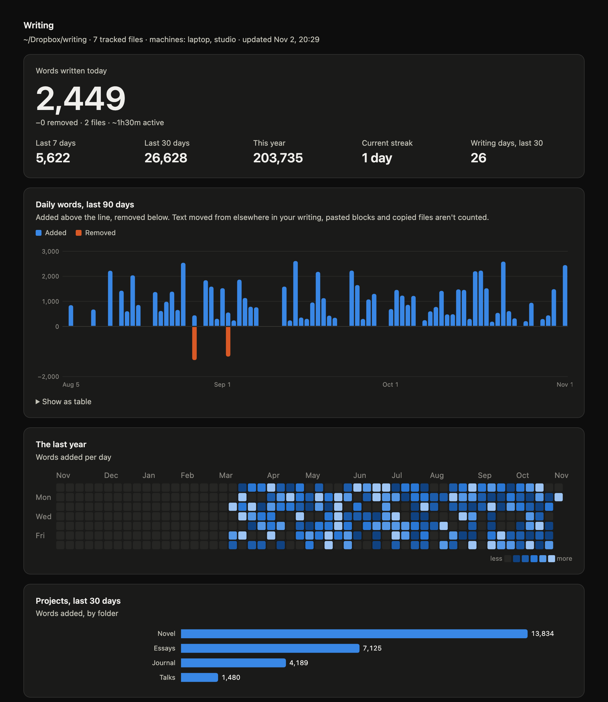

# wr0te

An ambient writing tracker for macOS.

I ([Craig Mod](https://craigmod.com/about)) made this because I find most writing
software doesn't track words properly, and writing is more messy than just
adding / deleting words. So much copying / moving / editing is involved. I
wanted to have a tool that could track all of my writing folders and create a
historical and accurate reference of how I've written and what I've written
over time. I hope you find it useful, and if you have a piece of writing
software, please feel free to integrate our methodologies into your own app.

Point it at the folders where you keep your writing (Markdown, Org or plain
text, in any editor). Every 5 minutes it notes what changed, then shows how
much you actually wrote: per day, per project, per file and by hour. Text you pasted in or moved from elsewhere doesn't count.

No editor plugin, no account, no network. Everything stays in files on your Mac
(or in your own Dropbox, if you write on more than one).

> **Privacy:** to tell new writing from old, wr0te keeps a compressed copy of
> every version of every file it sees, in a `wr0te-data` folder. That folder
> holds the full text of everything you've written. Don't share it.

## Requirements

- macOS
- Apple's Command Line Tools, for `python3`, `clang` and `swiftc`
  (`xcode-select --install` if you don't have them)

There is nothing else to install: wr0te is one Python file using only the
standard library.

## Install

    git clone https://github.com/cmod/wr0te.git
    cd wr0te
    python3 wr0te.py install ~/Dropbox/writing     # the folder you write in
    open ~/Applications/wr0te.app                 # click Allow if macOS asks
    python3 wr0te.py status

`install` saves the folder in your settings, builds a tiny launcher app in
`~/Applications/wr0te.app`, starts a background job that scans every 5
minutes, and adds a pencil to the menu bar.

macOS protects some folders: Dropbox and other cloud folders, Documents and
Desktop. Opening `wr0te.app` once lets macOS ask for access to yours. If
`status` shows `NO PERMISSION` in the recent scans, open the app again and
click Allow.

The first scan is a baseline: what's already there doesn't count as writing.
Only changes from then on do.

## Use

    python3 wr0te.py today      # the last 7 days in the terminal
    python3 wr0te.py open       # build and open the HTML report
    python3 wr0te.py status     # is the background job running? recent scans
    python3 wr0te.py notify-test

The report is rebuilt in the background whenever something changes, at
`~/Library/Application Support/wr0te/report.html`, along with `daily.csv` for
spreadsheets.

The menu bar pencil gets a check mark once you reach the day's goal. Click it
for today's words, words removed, files, active time, goal progress and days
written. **Copy Today's Stats** (⌘C) copies a one-line summary, and **Open
Report** scans right away, rebuilds the report and opens it in your browser.
Quit hides it until you next log in; set `"menu_bar": false` and run `install`
again to turn it off.

When the day's written words reach the daily goal (2,000 unless you change it),
you get a notification from wr0te. The first time, macOS asks whether wr0te may
send notifications. If you write in a Focus mode, add wr0te to that Focus's
allowed apps, or the notification goes quietly to Notification Center. Without
the menu bar app, the notification comes from Script Editor instead.

## Settings

Settings live in `~/Library/Application Support/wr0te/config.json`. `install`
sets the first folder; everything else is optional:

    {
      "folders": [
        {"path": "~/Dropbox/writing"},
        {"name": "newsletter", "path": "~/Sites/newsletter/issues"}
      ],
      "data": "~/Dropbox/wr0te-data",
      "daily_goal": 2000,
      "day_start_hour": 4,
      "dont_count": ["*backup*", "misc"],
      "hide_folders": ["Projects"],
      "menu_bar": true,
      "show_streak": true
    }

- `folders`: the folders to watch. A folder's files show up in reports as
  `name/...`; one folder can go without a name, and its files show up as they
  are. What's already in a folder when you add it is a baseline, not new
  writing. A folder missing on one Mac is skipped there, not counted as
  deleted. (Older settings files used `root` and `also_watch`; they still work.)
- `data`: where the history goes. Defaults to `wr0te-data` next to the folder
  without a name.
- `daily_goal`: words for the daily notification. `0` turns it off.
- `day_start_hour`: writing before this hour counts toward the previous day.
- `dont_count`: folders whose writing isn't counted, like notes or backups.
  Their files are still tracked, so text moved out of them is recognized as
  moved. A rule without a slash matches folder names anywhere (`misc`,
  `*backup*`); one with a slash matches a folder's path as reports show it
  (`Novel/Research`). Case doesn't matter.
- `hide_folders`: leading folders left off paths in reports
  (`Projects/Novel/ch1.md` shows as `Novel/ch1.md`).
- `show_streak`: the streak and days-written counts in the menu bar and report.
- `menu_bar`: today's words in the menu bar. Run `install` again after changing it.

The menu bar's **Settings…** (⌘,) edits the folders, goal, day start and
streak without opening the file, and **Update Now** (⌘U) scans right away. wr0te reads the file every time it runs, so there's nothing to restart. The `WR0TE_ROOT`, `WR0TE_DATA` and
`WR0TE_MACHINE` environment variables override the paths and this Mac's name.
Tuning constants (typing speed, fingerprint size) are at the top of `wr0te.py`.

## More than one Mac

Install on each Mac with the same folder. If the folder is in Dropbox,
`wr0te-data` (next to it) syncs too, and every Mac's report shows all your
writing. Each Mac appends only to its own log, so Dropbox never has to merge a
file, and a change seen by two Macs counts once.

- In Dropbox, set `wr0te-data` to **Make available offline** on every Mac. The
  background job can't make Dropbox download a file. Until another Mac's log
  arrives, the report stays as it was and `scan.log` says "waiting for log to
  sync".
- The goal notification comes once a day, from whichever Mac was used in the
  last 10 minutes.
- Settings are per Mac, so copy `config.json` across if you've changed more
  than the first folder.

## What counts

Each change is a word-level diff between two versions of a file. Chinese,
Japanese and Korean characters count one each. Every block of new text is then
sorted into one of three kinds:

- **Moved**: the text already existed somewhere in your writing, in any past
  version of any file. That covers pulling from a diary, copying from an older
  draft, reordering and restoring after a delete. Matching uses 8-word
  fingerprints kept in a local index (`archive.db`, rebuildable from the
  snapshots).
- **Pasted**: new text you couldn't have typed since the scanner last saw the
  file (90 words a minute, and never less than about 450 words per 5-minute
  scan). That's any single block longer than that, and if several smaller
  blocks add up to more, the biggest of them. If the Mac was asleep, the window
  is longer, so writing done elsewhere still counts.
- **Written**: everything else. This is the number on the charts.

Text cut from one place and put back elsewhere doesn't count as removed.
Renamed or duplicated files, and the first scan on each Mac, count as nothing.

Limits:

- Typing and pasting in the same 5-minute window with no gap between them
  counts the typed part as pasted.
- With an editor that saves only when you tell it to, typing between saves can
  look like pasting.
- **Active time** is the number of 5-minute windows with a saved change, so
  it's approximate.

## Where things live

| What | Where | Synced? |
|---|---|---|
| Every Mac's log of changes | `wr0te-data/logs/<machine>/YYYY-MM.jsonl` | with your writing, if `data` is in Dropbox |
| Every distinct file version, gzipped | `wr0te-data/snapshots/` | with your writing, if `data` is in Dropbox |
| Settings, scan state, index, report, `daily.csv` | `~/Library/Application Support/wr0te/` | no |
| Launcher and menu bar apps | `~/Applications/wr0te.app`, `wr0te-menu.app` | no |

Everything except `config.json` and `wr0te-data` can be deleted and rebuilt.

## Permissions and safety

- The background job runs `wr0te.app`, a small launcher (`launcher.c`), so
  that folder access is granted to that app alone, not to every Python script.
  **Don't give it Full Disk Access**; it doesn't need it.
- Whatever the launcher runs gets that access, so it's locked down: the
  system Python in isolated mode (`-I`: no `PYTHON*` variables, no user
  site-packages, no modules from the script's folder), a minimal environment,
  and no arguments. It's rebuilt only when `launcher.c` changes, because a new
  binary can lose the permission.
- Anyone who can edit `wr0te.py` can run code with that access. Keep the clone
  somewhere only you can write to. Releases are tagged: check out the latest
  tag rather than following `main`, and read what changed before you move to a
  newer one.
- The menu bar app (`menubar.swift`) needs no permissions. It reads
  `today.json`, which each background run writes next to the report (with the
  size of your history, since the app can't look inside Dropbox), and writes
  only `config.json`, from Settings. Open Report and Update Now ask
  `wr0te.app` to do the scan.
- Logs arriving from other Macs are checked (hash format, types, ranges)
  before use. Snapshot reads are size-capped, and data and state files are
  readable only by you.

## Development

    python3 -m unittest

The tests run in temporary folders and don't touch your settings, data or
launchd.

The app icon is drawn in `assets/icon.svg`; `assets/wr0te.icns` is built from
it (render at 1024px, then `iconutil`). `install` copies it into the menu bar
app.

## Uninstall

    python3 wr0te.py uninstall      # stops and removes the background job and menu bar app
    rm -rf ~/Applications/wr0te.app ~/Applications/wr0te-menu.app ~/Library/Application\ Support/wr0te

Your history is still in `wr0te-data`. Delete that too if you don't want it.

## License

MIT. See [LICENSE](LICENSE).
